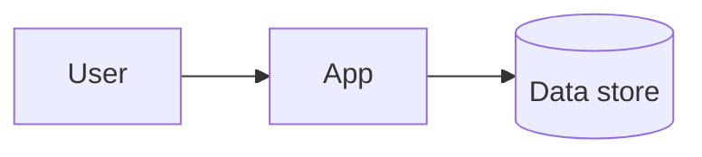

# Architecture

Update this file in the same pull request as any structural change.

## Big picture



## Components

- **App**: what it does, where it lives (`src/...`).
- **Data store**: what it holds, who writes to it.

## Key decisions

See [docs/adr](docs/adr).

## How to run and test

```bash
# commands
```
