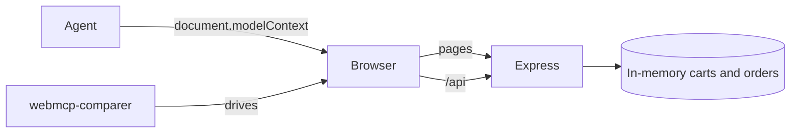

# Architecture

Update this file in the same pull request as any structural change.

## Big picture



## Components

- **Shop app** (`app/`): React 19, Vite and React Router single-page app in `app/src`. Routes: `/`, `/cart`, `/order/:id`. All API calls go through `app/src/shop.ts`.
- **WebMCP tools** (`app/src/webmcp/`): `useWebMCPTool` registers a tool with `document.modelContext` while a component is mounted and aborts the registration on unmount. `tools.ts` holds each tool's definition; the page that owns the tool supplies the code that runs it, and `ShopTools.tsx` registers the tools that belong to no page.
- **Shop server** (`app/server.js`): Express. Serves the API under `/api`, and the pages (Vite middleware in dev mode, `app/dist` after `vite build`). Carts and orders live in memory, one cart per browser cookie.
- **Comparer** (`webmcp-comparer/`): runs a scenario on a site with and without WebMCP. See its own `ARCHITECTURE.md`.

## Key decisions

See [docs/adr](docs/adr).

## How to run and test

```bash
cd app && npm install
npm start          # build, then http://localhost:4000
npm run dev        # Vite hot reload on the same port
npm test && npm run typecheck
```
